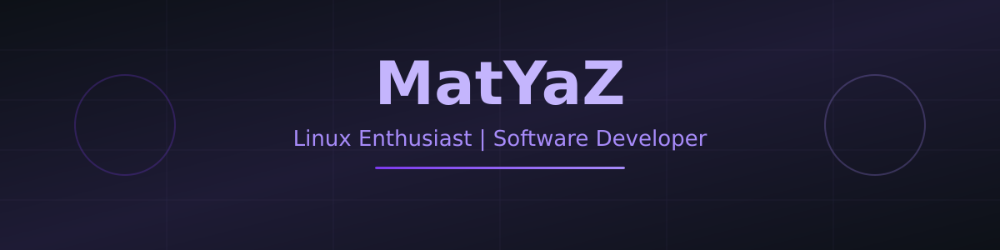

---

## About Me

I am a software developer with a strong interest in Linux and open-source technologies. I enjoy exploring different Linux distributions, building applications, and learning new tools and programming languages. I work with both low-level and web technologies, and I continuously improve my skills through personal projects and experimentation.

---

## Linux Distributions

| Distribution | Role |
| :--- | :--- |
|  **Fedora** | Main operating system |
|  **Pop!_OS** | Secondary Linux environment |
|  **Ubuntu** | Development and testing environment |
|  **NixOS** | Distribution of interest |
|  **EndeavourOS** | Distribution of interest |
|  **Debian** | Distribution of interest |

---

## Tech Stack

### Programming Languages

### Frontend Development

---

## Tools & Environment

 

---

## Featured Projects

### Virgil

Personal assistant developed in C++. Console-based interface, with code organized into header and source files. A learning and personal development project.

**Tech:** C++

**Repository:** TODO — add repository URL

### gastos-app

Expense management application. Frontend built with React and TypeScript; backend developed with Python.

**Tech:** React, TypeScript, Python

**Repository:** TODO — add repository URL

---

## GitHub Stats

---

*Learning, building, and exploring the open-source world.*
